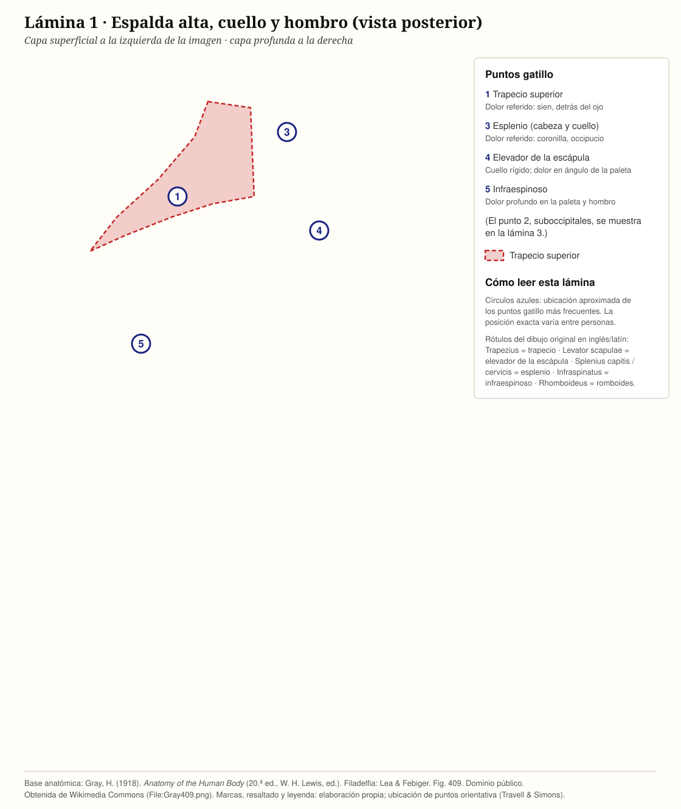
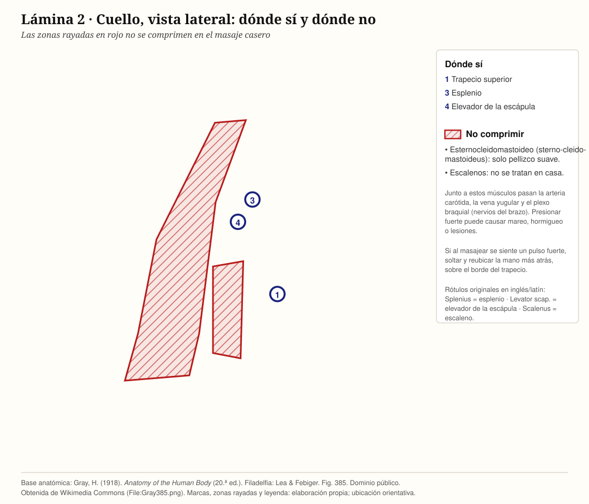
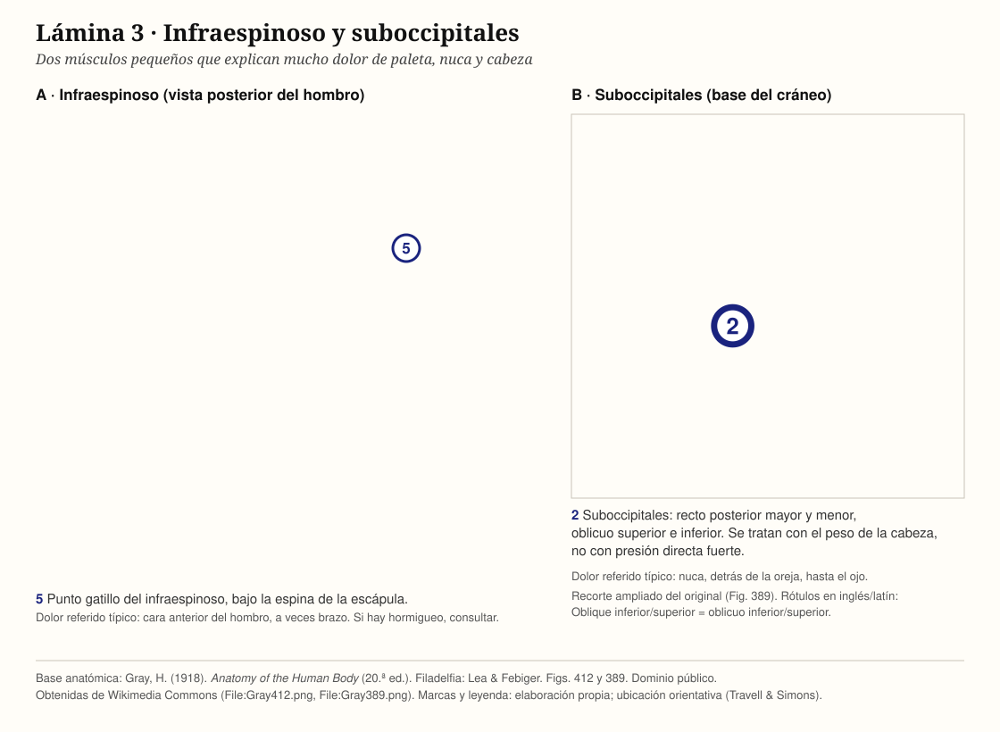
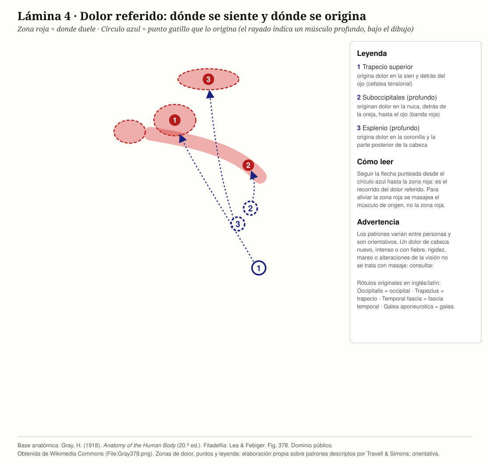
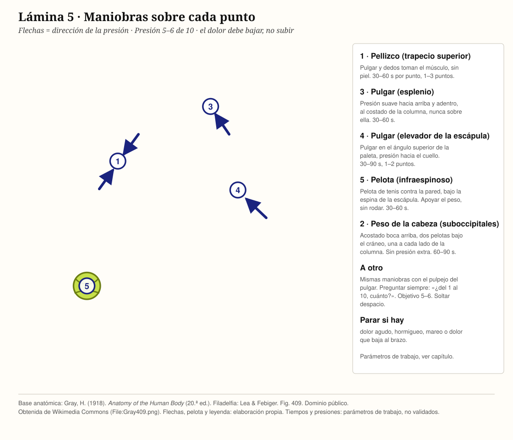

# Cuello y hombros

> **En una línea:** la mayor parte del dolor de nuca, cabeza y "paleta" viene de cuatro músculos sobrecargados (trapecio superior, elevador de la escápula, esplenio y suboccipitales), y a menudo el punto doloroso no es el punto que hay que tratar.

> Estado: **borrador v1 para revisión**. Los tiempos y presiones son parámetros de trabajo (ver sección "Qué está respaldado y qué no").

---

## 0. Antes de empezar (leer siempre)

**No masajear y consultar primero si hay:**
- Golpe, caída o latigazo (accidente de tránsito) reciente.
- Dolor de cabeza muy intenso y nuevo, o "el peor de mi vida".
- Fiebre, rigidez de nuca con imposibilidad de llevar el mentón al pecho, o malestar general.
- Hormigueo, adormecimiento, pérdida de fuerza o dolor eléctrico que baja al brazo o la mano.
- Mareo, visión doble, dificultad para hablar o tragar.
- Ganglios inflamados o dolorosos, o un bulto en el cuello (sobre todo si late).
- Antecedente de cáncer, osteoporosis o infección, o pérdida de peso sin explicación.
- Dolor que lleva más de unas 6 semanas sin mejorar, o que va empeorando.

**Zonas donde NO se presiona nunca:**
- **Cara anterior y laterales del cuello, bajo la mandíbula:** pasan la arteria carótida y la tiroides. Si se siente un pulso fuerte, se está en un lugar equivocado.
- **Columna cervical (las vértebras que se palpan en la línea media de la nuca):** presionar sobre el hueso no tiene beneficio y puede dañar.

**Regla de parada:** si durante el masaje aparece dolor agudo, hormigueo, mareo o dolor que baja al brazo, se suspende en el acto.

---

## 1. Anatomía de la zona

*Lámina 1. Base: Gray (1918), Fig. 409, dominio público. Marcas propias.*

*Lámina 2. Base: Gray (1918), Fig. 385, dominio público. Zonas de no compresión y marcas propias.*

| Músculo | Dónde está | Qué hace | Cuándo se sobrecarga |
|---|---|---|---|
| **Trapecio superior** | Del cráneo y la nuca al hombro (el "borde" entre cuello y hombro) | Eleva el hombro, inclina el cuello | Escritorio, estrés, cargar bolsos, teléfono entre hombro y oreja |
| **Elevador de la escápula** | De las primeras vértebras cervicales al ángulo superior de la paleta | Sube la paleta, gira el cuello | Dormir mal, cuello rígido al despertar, girar la cabeza al manejar o jugar al tenis |
| **Esplenio de la cabeza y del cuello** | Bajo el trapecio, de las vértebras al cráneo (detrás de la oreja) | Extiende y gira la cabeza | Mirar hacia abajo mucho tiempo, pantalla, lectura |
| **Suboccipitales** | Cuatro músculos pequeños bajo el cráneo | Ajustan la posición fina de la cabeza | Cabeza adelantada, tensión mantenida |
| **Infraespinoso y supraespinoso** | En la paleta, encima y debajo de la espina | Mueven y estabilizan el hombro | Tenis, golf, levantar los brazos, dormir sobre el hombro |
| **Esternocleidomastoideo (ECM)** | Del esternón y la clavícula a detrás de la oreja | Gira e inclina la cabeza | Cuello adelantado, respiración alta |
| **Escalenos** | Laterales del cuello, junto a nervios y vasos | Inclinan el cuello, ayudan a respirar | Respiración alta, estrés |

> **Nota de seguridad:** el ECM y los escalenos están junto a vasos y nervios importantes. En esta guía **no se aplica compresión sobre ellos en casa**; solo se incluye una maniobra suave de ECM (sección 5).

---

## 2. Mapa de dolor referido

*Lámina 3. Base: Gray (1918), Figs. 412 y 389, dominio público. Marcas propias.*

*Lámina 4. Base: Gray (1918), Fig. 378, dominio público. Zonas de dolor y puntos: elaboración propia, orientativa.*

Un **punto gatillo** es un nudo doloroso dentro de una banda tensa de músculo. Al presionarlo puede doler **en otro lugar**: eso es el dolor referido.

| Si duele… | El origen puede estar en… | Dónde buscar el punto |
|---|---|---|
| Sien y detrás del ojo, tipo "casco" o dolor de cabeza tensional | Trapecio superior; suboccipitales | Borde superior del trapecio, a mitad entre nuca y hombro; base del cráneo |
| Nuca y detrás de la oreja, que llega hasta el ojo | Suboccipitales | Base del cráneo, a ambos lados de la columna |
| Cuello rígido al despertar, imposible girar | Elevador de la escápula | Ángulo superior de la paleta y el cuello lateral bajo |
| Dolor en la coronilla o en la parte posterior de la cabeza | Esplenio | Lateral y bajo de la nuca |
| "Peso" en los hombros, nudo en el hombro | Trapecio superior | Punto más tenso del borde superior del hombro |
| Dolor profundo en la paleta, "como una uña" | Infraespinoso; elevador de la escápula | Zona media de la paleta; ángulo superior |
| Dolor que baja desde el hombro por el brazo, sin hormigueo | Infraespinoso | Paleta (ver alarma si hay hormigueo) |

> **Importante:** estos patrones son una **guía de orientación**, no un diagnóstico. El dolor referido varía de persona a persona. La combinación de varios síntomas (por ejemplo, dolor de cabeza + cuello rígido + hombro) es lo que da la pista.

---

## 3. Causas frecuentes

- **Postura sostenida:** pantalla, teléfono, manejar. La cabeza adelantada multiplica la carga sobre la nuca.
- **Estrés y mandíbula apretada:** sube los hombros sin darse cuenta.
- **Gesto deportivo repetitivo:** tenis, golf, natación, levantar pesas.
- **Sueño:** almohada alta o baja, dormir boca abajo con el cuello girado.
- **Sobrecarga:** cargar bolsos o mochilas de un solo lado, cargar chicos.

---

## 4. Principios del masaje en esta zona

| Parámetro | Valor de trabajo |
|---|---|
| **Presión** | **5–6 sobre 10.** Incomoda pero se puede respirar tranquilo. Si se contrae el rostro o se aguanta la respiración, es demasiado. |
| **Compresión sostenida en un punto** | **30–90 segundos**, esperando que el dolor baje. |
| **Puntos por músculo** | 1–3 |
| **Amasado o fricción suave** | 1–2 minutos por músculo |
| **Duración total por sesión** | **8–12 minutos** |
| **Frecuencia** | 1 vez por día, como máximo 2; no sobre zona irritada ni inflamada |
| **Después** | Calor suave, movilidad lenta del cuello, agua |

**Cómo hacerlo bien:**
1. Calentar la zona con las manos o una toalla tibia.
2. Presionar **gradualmente** hasta sentir el punto; no clavar de golpe.
3. Mantener, respirando lento. El dolor tiene que ir **bajando**, no subiendo.
4. Soltar despacio. Nunca soltar de golpe.
5. Terminar con amasado suave.

**Señal de que va bien:** sensación de "dolor rico", calor, alivio al soltar.
**Señal de que hay que aflojar o parar:** dolor que sube, hormigueo, mareo, dolor eléctrico, moretones, dolor que persiste y empeora después.

---

## 5. Técnica por músculo

*Lámina 5. Base: Gray (1918), Fig. 409, dominio público. Flechas y leyenda: elaboración propia.*

### 5.1 Trapecio superior

**Auto-masaje**
- **Posición:** sentado, brazo del lado a tratar apoyado sobre una mesa o el muslo, hombro relajado.
- **Maniobra:** con la mano contraria, "pellizco" suave: el músculo se toma entre el pulgar y los otros dedos, **sin pellizcar piel**, y se mantiene.
- **Dónde:** el borde superior del hombro, a mitad entre el cuello y el extremo del hombro.
- **Tiempo:** 30–60 s por punto, 1–3 puntos, luego amasado de 1–2 min.

**Variante con pelota** (pared): pelota de tenis entre la espalda y la pared, sobre el trapecio, y se hace presión con el peso del cuerpo. 30–60 s por punto.

**A otro**
- **Posición:** la persona sentada, o boca abajo con almohada bajo el pecho. Quien masajea, detrás.
- **Maniobra:** pulgar o pulpejo de los dedos en el punto, o amasado con ambas manos entre pulgar y dedos.
- **Presión:** preguntar siempre: "¿del 1 al 10, cuánto?". Objetivo 5–6.
- **Tiempo:** 30–90 s por punto, 1–3 puntos, amasado 1–2 min por lado.

### 5.2 Elevador de la escápula

**Auto-masaje**
- **Posición:** sentado, mano contraria sobre el ángulo superior de la paleta (esquina de arriba, junto a la columna).
- **Maniobra:** presión con las yemas, **hacia el hombro**, mientras la cabeza se inclina suavemente hacia el lado opuesto.
- **Tiempo:** 30–60 s por punto, 1–2 puntos.

**A otro**
- **Posición:** boca abajo, o sentado con el torso inclinado hacia delante sobre una mesa con almohada.
- **Maniobra:** pulgar sobre el ángulo superior de la paleta, presión hacia arriba y adentro; luego fricción lenta hacia el cuello.
- **Tiempo:** 30–90 s por punto, 1–2 puntos.

### 5.3 Suboccipitales

**Auto-masaje**
- **Posición:** acostado boca arriba, dos pelotas de tenis (o dos pelotas dentro de una media) bajo la base del cráneo, **un lado a cada lado de la columna, nunca sobre ella**.
- **Maniobra:** dejar caer el peso de la cabeza sobre las pelotas, sin mover, respirando.
- **Tiempo:** 60–90 s. Sin presión extra: el peso de la cabeza alcanza.

**A otro**
- **Posición:** la persona boca arriba, cabeza descansando sobre las manos de quien masajea.
- **Maniobra:** yemas de los dedos bajo la base del cráneo, a ambos lados de la columna, con dedos hacia arriba y adentro. Mantener la presión suave y dejar que la cabeza "caiga" sobre los dedos.
- **Tiempo:** 60–90 s.

### 5.4 Esplenio

**Auto-masaje**
- **Posición:** sentado, mano contraria detrás de la nuca.
- **Maniobra:** yemas sobre el músculo lateral de la nuca (a un lado de la columna, nunca sobre ella), con presión suave mientras se gira la cabeza lentamente hacia el lado que se trata.
- **Tiempo:** 30–60 s por punto.

**A otro**
- **Posición:** boca abajo o sentado hacia delante sobre una almohada.
- **Maniobra:** amasado suave con pulgar y dedos a lo largo del músculo, de la base del cráneo hacia abajo.
- **Tiempo:** 1–2 min por lado.

### 5.5 Infraespinoso (paleta)

**Auto-masaje**
- **Posición:** de pie, pelota de tenis entre la espalda y la pared, sobre la parte media de la paleta (debajo de la espina).
- **Maniobra:** apoyar el peso, mover el cuerpo apenas hacia arriba y abajo o mantener el punto.
- **Tiempo:** 30–60 s por punto.

**A otro**
- **Posición:** boca abajo, brazo hacia un lado.
- **Maniobra:** pulgar o nudillo sobre el músculo, debajo de la espina de la paleta, en círculos pequeños y lentos.
- **Tiempo:** 30–90 s por punto.

### 5.6 Esternocleidomastoideo (solo maniobra suave)

- **Cuándo:** solo si el cuello lateral está tenso y **no hay mareo ni dolor que baje al brazo**.
- **Maniobra:** tomar el músculo **suavemente** entre pulgar y dedos (se siente como una cuerda que va de detrás de la oreja a la clavícula) con el cuello apenas inclinado hacia ese lado. **Sin presión profunda ni compresión.** Si se siente el pulso, se está en la zona de la carótida: soltar y reubicar.
- **Tiempo:** 20–30 s, 1 vez.

---

## 6. Secuencia express (10 minutos)

| Minuto | Qué |
|---|---|
| 0–1 | Calor con manos o toalla tibia, respiración lenta |
| 1–3 | Trapecio superior (amasado + 1–2 puntos) |
| 3–5 | Elevador de la escápula |
| 5–7 | Suboccipitales (peso de la cabeza) |
| 7–9 | Infraespinoso (si hay dolor de paleta) |
| 9–10 | Movilidad lenta del cuello: inclinar y girar suavemente, 3 veces a cada lado |

---

## 7. Cuándo consultar

Consultar a un profesional si:
- Hay alguna de las señales de alarma de la sección 0.
- No hay mejoría tras **2 semanas** de masaje regular, o el dolor empeora.
- El dolor despierta de noche o no se calma con el reposo.
- Dolores de cabeza que aumentan en frecuencia o intensidad.

---

## 8. Qué está respaldado y qué no

| Afirmación | Estado |
|---|---|
| La compresión isquémica sobre puntos gatillo del trapecio superior reduce el dolor de cuello a corto plazo | **Respaldado** (evidencia moderada en una revisión sistemática; beneficio en dolor, umbral de dolor y movilidad en un metaanálisis posterior). Los efectos son principalmente inmediatos y de corto plazo. |
| Duración de 30–90 s por punto | **Parcialmente respaldado.** Los ensayos usaron protocolos variados (por ejemplo, 60–90 s); no hay una duración óptima demostrada. Es un parámetro de trabajo. |
| Presión 5–6/10 | **Criterio práctico.** Es consistente con aplicar presión "hasta el inicio del dolor" que usan los protocolos, pero no es un valor validado. |
| Sesión total de 8–12 minutos y frecuencia diaria | **Criterio práctico**, sin respaldo específico. |
| Mapas de dolor referido | **Basados en fuentes secundarias** que resumen a Travell y Simons. Hay que contrastarlos con el manual original antes de la versión final. |
| Zonas de no presión y alarmas | **Consistentes entre varias fuentes de salud**, pero parte de la guía sobre riesgo vascular proviene de fuentes de divulgación. Pendiente de contraste con fuente clínica. |

---

## Fuentes

- Revisión sistemática de ensayos sobre puntos gatillo del trapecio superior (compresión isquémica y punción seca): [PubMed 25768071](https://pubmed.ncbi.nlm.nih.gov/25768071/)
- Metaanálisis sobre compresión isquémica en puntos gatillo miofasciales para dolor de cuello: [QxMD](https://read.qxmd.com/read/36872769/effectiveness-of-ischemic-compression-on-myofascial-trigger-points-in-relieving-neck-pain-a-systematic-review-and-meta-analysis) · [Journal of Back and Musculoskeletal Rehabilitation](https://journals.sagepub.com/doi/full/10.3233/BMR-220045)
- Señales de alarma en dolor de cuello: [GPnotebook](https://gpnotebook.com/en-GB/pages/rheumatology/red-flags-in-neck-pain) · [Mayo Clinic](https://mayoclinic.org/symptoms/neck-pain/basics/when-to-see-doctor/sym-20050882) · [HSS](https://www.hss.edu/health-library/move-better/when-to-see-doctor-for-neck-pain)
- Patrones de dolor referido (fuentes secundarias, a contrastar con *Travell & Simons, Myofascial Pain and Dysfunction: The Trigger Point Manual*): [Headaches Outside the Head](https://acupuncturetoday.com/article/32796-headaches-outside-the-head) · [Head and shoulder pain](https://www.massagetoday.com/mpacms/mt/article.php?id=15149)

## Pendiente

- [x] Láminas anatómicas 1–3 sobre Gray (1918), dominio público, con cita
- [x] Láminas 4 (dolor referido) y 5 (maniobras) sobre Gray (1918)
- [ ] Maniobras a otro: evaluar fotos o ilustración propia de manos (el atlas no las incluye)
- [ ] Verificar ubicación de los puntos gatillo contra Travell & Simons y con un profesional
- [ ] Contrastar mapas de referido con el manual de Travell y Simons
- [ ] Revisión por un profesional de salud
- [ ] Prueba real de la secuencia express con 2–3 personas
